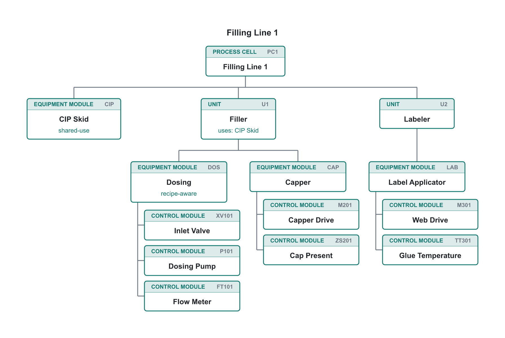
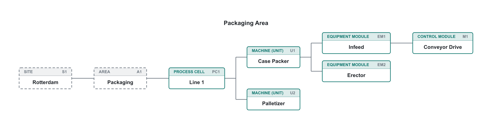

# Physical Model Charts

**ISA-88 physical models** (ANSI/ISA-88.00.01-2010 §4.4) from a small, indentation-based
text DSL, rendered to themed SVG. One framework-agnostic core drives the Obsidian, VS
Code and Fumadocs targets. This is the sibling project of
[PFC Charts](../pfc-charts), built on the same architecture.

<p align="center">
  
</p>

That diagram is the entire output of this text (drop it in a ` ```physical ` fenced
block):

```physical
physical Filling Line 1
cell PC1 "Filling Line 1"
  em CIP "CIP Skid" shared
  unit U1 "Filler"
    uses CIP
    em DOS "Dosing" recipe-aware
      cm XV101 "Inlet Valve"
      cm P101 "Dosing Pump"
      cm FT101 "Flow Meter"
    em CAP "Capper"
      cm M201 "Capper Drive"
      cm ZS201 "Cap Present"
  unit U2 "Labeler"
    em LAB "Label Applicator"
      cm M301 "Web Drive"
      cm TT301 "Glue Temperature"
```

`direction LR` gives a left-to-right tree. Enterprise, site and area are drawn dashed,
as in Part 1 Figure 3:

<p align="center">
  
</p>

Add `use-colors` to color each equipment level: process cells purple, units blue,
equipment modules green and control modules orange. The hues come from the host's
theme palette (Fumadocs uses fixed light and dark values).

The parser enforces the Part 1 containment rules. Levels may be omitted but never
rearranged, compound EMs and CMs are allowed, the site and process cell may not be
skipped, and a train stays within one process cell. `strict` adds the completeness
rules. The full language reference is in
[pm-source/obsidian/DOCUMENTATION.md](pm-source/obsidian/DOCUMENTATION.md).

## Repository layout

```
pm-source/
  core/        shared engine — parser, layout, SVG renderer (package @pm/core)
  obsidian/    Obsidian plugin adapter (consumes @pm/core)
  vscode/      VS Code Markdown-preview extension (consumes @pm/core)
  fumadocs/    Fumadocs (Next.js + MDX) adapter (consumes @pm/core)
pm-skills/     AI authoring skill (SKILL.md + examples) for writing physical models
scripts/       README preview renderer (npm run preview)
output/        generated build artifacts (git-ignored, safe to delete)
build.mjs      build orchestrator -> output/<target>
```

`core/`, `obsidian/`, `vscode/` and `fumadocs/` are npm workspaces. The adapters import
the shared engine as `@pm/core`.

## Commands

Run from the repository root:

```bash
npm install
npm run build            # type-check + build every target -> output/
npm run build:obsidian   # build only the Obsidian target
npm run build:vscode     # build only the VS Code target
npm run build:fumadocs   # build only the Fumadocs target
npm run pack:fumadocs    # build + pack the Fumadocs adapter -> output/pm-fumadocs-<v>.tgz
npm run dev              # watch-rebuild the Obsidian target
npm test                 # parser/layout/render unit tests
npm run preview          # re-render the README images in assets/
npm run icon             # rasterise the VS Code icon
npm run lint             # eslint
npm run format           # prettier --write
```

## Targets

- **Obsidian**: built to `output/obsidian/` (`main.js`, `manifest.json`, `styles.css`).
  Renders ` ```physical ` blocks. See
  [pm-source/obsidian/README.md](pm-source/obsidian/README.md).
- **VS Code**: a Markdown-preview extension built to `output/vscode/`. See
  [pm-source/vscode/README.md](pm-source/vscode/README.md).
- **Fumadocs**: a Next.js + MDX adapter (`@pm/fumadocs`) built to `output/fumadocs/`. A
  React Server Component and an optional remark plugin render ` ```physical ` fences as
  static inline SVG (no client JS). See
  [pm-source/fumadocs/README.md](pm-source/fumadocs/README.md).

All three coexist with the PFC Charts targets: the fences (`physical` / `pfc`), CSS
prefixes (`pm-` / `pfc-`), plugin ids and package names are all distinct.

## Releasing a new version

Each target versions independently, with one version source of truth per target. Bump
it, rebuild, then ship using the per-target step below.

### Obsidian

1. Bump `version` in [pm-source/obsidian/manifest.json](pm-source/obsidian/manifest.json)
   (and `minAppVersion` if it changed).
2. Add a `"<version>": "<minAppVersion>"` entry to
   [pm-source/obsidian/versions.json](pm-source/obsidian/versions.json).
3. Run `npm run build:obsidian`, then ship the three files in `output/obsidian/`. Either
   attach them to a GitHub release tagged with the exact version, or copy them into
   `<vault>/.obsidian/plugins/physical-model-charts/`.

### VS Code

1. Bump `version` in [pm-source/vscode/package.json](pm-source/vscode/package.json) and
   add a matching entry to [pm-source/vscode/CHANGELOG.md](pm-source/vscode/CHANGELOG.md).
   Bump it by hand: `vsce publish patch|minor|major` would only bump the build copy in
   `output/vscode/`, which the next build overwrites.
2. `npm run build:vscode`.
3. Package from `output/vscode/` (`--no-dependencies`: the extension is fully bundled into
   `dist/extension.js`):
   ```bash
   cd output/vscode
   npx @vscode/vsce package --no-dependencies   # -> physical-model-charts-<v>.vsix
   ```
4. Publish by uploading the `.vsix` at <https://marketplace.visualstudio.com/manage>
   (publisher `acro`): **New extension → Visual Studio Code** the first time, then
   **Update** from the extension's **More actions** menu for later versions. Installed
   copies update automatically. A version number can never be reused.

   Command-line alternative: `vsce login acro`, then
   `npx @vscode/vsce publish --no-dependencies`. That needs an Azure DevOps PAT
   (organization **All accessible organizations**, scope **Marketplace › Manage**). Such
   global PATs are retired on December 1, 2026; after that, command-line publishing needs
   Microsoft Entra ID (`vsce publish --azure-credential`).

### Fumadocs

1. Bump `version` in [pm-source/fumadocs/package.json](pm-source/fumadocs/package.json).
2. `npm run pack:fumadocs` builds and packs to `output/pm-fumadocs-<version>.tgz`.
3. In the docs app, install the new tarball and restart the dev server.

## License

MIT
